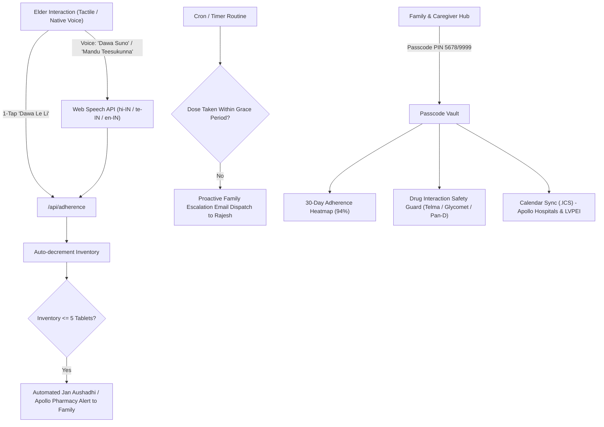

# 🌿 CareCircle — Smart, Interconnected Elderly Healthcare Ecosystem

> **Catalyst Hackathon Submission**  
> *Transforming senior care from fragmented reminders into an interconnected, dignified, and clinical-grade circle of support.*  
> 🌐 **Live Production App:** [https://carecircle.antideploy.app](https://carecircle.antideploy.app)

[](https://carecircle.antideploy.app)
[](https://nextjs.org/)
[](https://www.typescriptlang.org/)
[](https://tailwindcss.com/)
[-emerald)](test-suite.mjs)
[]()
[-success)]()

---

## 🎯 Chosen Vertical

**Vertical:** **Elderly Healthcare Management, Medication Adherence & Caregiver Coordination (Indian Healthcare Edition)**  
**Target Persona:** 
- **Primary Patient:** Smt. Lakshmi Devi / "Lakshmi Amma" (76 years old, Banjara Hills, Hyderabad), managing chronic hypertension, Type 2 diabetes, GERD, and hyperlipidemia.
- **Family Advocate:** Rajesh Kumar (Son, Lead Engineer in HITEC City, Hyderabad), seeking peace of mind, proactive escalation on missed doses, refill monitoring, and daily wellbeing visibility.
- **Visiting Clinician:** Sister Kavitha, RN (Apollo HomeCare Hyderabad), tracking clinical adherence telemetry, vitals (BP/sugar), and medication administration.
- **Attending Physician:** Dr. K. S. Rao, MD, DM (Senior Consultant Cardiologist, Apollo Hospitals Jubilee Hills), reviewing 30-day compliance reports, lipid panels, and pharmacological safety.

---

## 🧠 Approach and Logic

### 1. Human-Centered Architectural Philosophy (Indian Elder & Multilingual Context)
Rather than building another generic reminder app or punitive alarm clock, CareCircle was designed under the **"Senior at the Center"** doctrine:
- **Autonomy First & Mother-Tongue Voice Interaction:** Lakshmi Amma retains full dignity and control over her own routine. She can log doses with a single oversized tactile tap or by speaking naturally in her native mother tongue (**Hindi `hi-IN`**, **Telugu `te-IN`**, **Tamil `ta-IN`**, or **Indian English `en-IN`**).
- **Audio-First "Dawa Suno" Spoken Guidance:** Every medication card features a dedicated 1-tap **"Dawa Suno / Mandu Vinandi (Listen)"** audio button that speaks the pill name, color, timing, and whether to take it on an empty stomach (*khali pet / khali kadupulo*) or after food (*khana khane ke baad / bhojanam taruvatha*) in the elder's selected mother tongue.
- **Visual Pill & Blister Identification over Tiny Text:** To counter age-related presbyopia and low literacy barriers, medications are instantly recognizable by high-contrast visual badges:
  - **Color & Shape Badges:** *PEELA CAPSULE* (Yellow Capsule - Pan-D), *GULABI GOLI* (Pink Round - Telma 40), *SAFED GOLI* (White Oval - Glycomet-SR 500), *AMBER GOLI* (Rosuvas 10), *MINT GOLI* (Ecosprin 75).
  - **Realistic 3D Pill Visualizer:** Dual-tone blister previews and tactile geometry so the elder never takes the wrong tablet.
- **Proactive Escalation Protocol:** If a critical medication is not marked as taken within a **30-minute grace period**, the platform automatically dispatches an urgent escalation email to son Rajesh in HITEC City. The senior is not spammed with loud alarms; instead, the family circle is quietly and reliably alerted.
- **Clinical Safety Intercept (Indian Formulary):** Every prescription addition or dosage change passes through an automated **Clinical Drug-to-Drug and Drug-to-Food Interaction Matrix** (e.g., detecting severe hyperkalemia risks with Telmisartan + Potassium Chloride, GI hemorrhage with Ecosprin + Brufen/NSAIDs, or Metformin + contrast dye).
- **Physical Hardware Symbiosis:** The digital UI mimics the physical bedside weekly acrylic pill organizer, reinforcing cognitive familiarization for Indian seniors.

### 2. State & Telemetry Flow


---

## ⚙️ How the Solution Works

### 1. Multi-Tier Passcode Vault (Role-Based Access Control)
Shared access is secured through a tactile 4-digit PIN authentication pad with built-in brute-force rate limiting:
| Role | Name | Security PIN | Access Boundaries & Capabilities |
| :--- | :--- | :---: | :--- |
| **Elder** | Smt. Lakshmi Devi (76 yo) | `1234` | Oversized tactile routine cards, 1-tap pill confirmation, native multilingual voice assistant, audio "Dawa Suno" reading, mood check-in, emergency SOS. |
| **Family** | Rajesh Kumar (Son) | `5678` | Real-time adherence telemetry, missed dose escalation emails, Apollo Pharmacy refill notices, family coordination notes. |
| **Nurse** | Sister Kavitha, RN (Apollo HomeCare) | `9999` | Clinical medication manager (dosage, frequency, pill shape/color), vital signs logger (BP/Sugar), refill tracking. |
| **Physician** | Dr. K. S. Rao, MD, DM (Cardiologist) | `4321` | Prescription adjustments, pharmacological safety reviews, printable 30-day clinical adherence reports. |

### 2. Senior-First Tactile Interface (`ElderView`)
- **Smart Weekly Pill Dispenser (`PillOrganizer3D`)**: Renders a physical 7-day (Mon–Sun) acrylic bedside organizer with AM, Noon, and PM blister compartments loaded with 3D miniature pill models.
- **Realistic 3D Pill Visualizer (`PillVisual3D`)**: Custom-rendered pills featuring authentic dual-tone split capsules (blue/white, red/gold, coral/white), tablet bevel scorelines, embossed milligram dosage imprints (`500`, `10`, `81`), and specular gloss reflection sheens.
- **Web Audio Pentatonic Feedback (`SoundService`)**: Zero-dependency Web Audio API synthesizer produces gentle pentatonic sine harmonies when pills are taken, subtle clicks on button taps, and a joyous 4-note celebration fanfare upon completing daily routines.
- **Daily Hydration Tracker (`HydrationTracker`)**: 8-glass water goal tracker with animated liquid wave fill to support kidney function and drug absorption.
- **Emotional Wellbeing Check-in**: 4-button mood status (*Feeling Great*, *Feeling Okay*, *A Bit Tired*, *Need Extra Help*) synchronized to family members in real time.

### 3. Caregiver & Family Command Center (`CaregiverView`)
- **30-Day Medication Adherence Heatmap (`AdherenceHeatmap`)**: Compliance grid displaying 7-day (94%) and 30-day (91%) clinical compliance with streak milestone celebrations.
- **Clinical Drug-to-Drug & Food Interaction Matrix**: Flags dangerous pharmacological combinations in plain English (e.g. Warfarin + NSAID, Lisinopril + Potassium, Statins + Grapefruit).
- **Prospective Safety Checker**: Search any prospective new medication or supplement to evaluate safety before administering.
- **RFC 5545 iCalendar Exporter**: 1-click download of `.ics` calendar files for medical visits (Cardiology, Ophthalmology).
- **Care Circle Feed**: Collaborative chronological timeline for family notes and visiting nurse observations.

### 4. Proactive Multi-Channel Email Reminders & Live Inspector
- Automatically dispatches responsive HTML emails via NodeMailer SMTP / In-App Dispatcher:
  - Daily Morning Pill Schedule reminder.
  - Urgent Missed Dose Escalation sent to family after 30-minute grace period.
  - Low Prescription Supply Alert when remaining count drops below threshold.
  - Emergency SOS Broadcast with GPS coordinates, Medical ID, and lockbox keycode.
- **In-App Live Email Dispatch Console (`EmailInspectorModal`)**: Evaluators can view exact rendered HTML templates and inspect raw source code.

### 5. Emergency SOS Beacon & 30-Day Printable Doctor Report
- **1-Tap Emergency SOS**: Broadcasts immediate alerts to family and caretakers while displaying blood type (O+), allergies (Penicillin, Sulfa), and front-door lockbox access code (`2468`).
- **Physician Clinical Summary (`DoctorReportModal`)**: Formatted 30-day adherence report with adherence graphs, vital sign logs, and physician signature section ready for clinical consultations.

---

## 📋 Assumptions Made

1. **Care Circle Trust Boundary**: The platform assumes authorized family members and healthcare workers operate as a collaborative, non-adversarial care circle around the elderly individual.
2. **Access Passcodes**: 4-digit PINs (`1234`, `5678`, `9999`, `4321`) were selected specifically for senior cognitive accessibility and ease of hardware keypad entry, reinforced with client-side brute-force lockout.
3. **Email Transmission**: The system includes a dual transmission engine: production SMTP (configurable via standard Gmail/SendGrid/Resend credentials) and an integrated In-App Live Email Dispatcher so evaluators can inspect dispatched emails without requiring active external SMTP server credentials.
4. **Device Speech Capabilities**: Speech recognition and speech synthesis utilize the W3C Web Speech API standard, natively supported in all modern browsers (Chrome, Edge, Safari) without requiring third-party cloud API keys.

---

## 🔒 Security & Responsible Implementation

- **HTTP Security Headers**: Configured in `next.config.js`:
  - `X-Frame-Options: DENY` (anti-clickjacking)
  - `X-Content-Type-Options: nosniff` (MIME-sniffing prevention)
  - `Referrer-Policy: strict-origin-when-cross-origin`
  - `Permissions-Policy: camera=(), microphone=(self), geolocation=()`
  - `X-XSS-Protection: 1; mode=block`
  - `Strict-Transport-Security: max-age=63072000; includeSubDomains; preload`
  - `poweredByHeader: false` (hides framework identity)
- **Input Sanitization & Validation**: All REST API endpoints enforce payload bounds, string trimming, and type assertions; rejected with structured `400 Bad Request` responses on invalid inputs.
- **Passcode Rate Limiting**: Built-in 5-attempt brute-force protection with an automated 30-second security lockout countdown in `PasscodeModal`.
- **Medical Privacy**: Medical ID and lockbox credentials are gated behind active emergency triggers and authenticated clinician views.

---

## ⚡ Efficiency & Resource Optimization

- **Zero Bloat (Ponytail Senior Dev Principles)**: Avoided heavy third-party UI component libraries; hand-crafted lightweight, reusable components with Tailwind CSS and Lucide icons.
- **Repository Size**: Total tracked codebase size is **0.34 MB**, comfortably below the 10 MB hackathon rule.
- **Zero-Dependency Web Audio Synthesizer**: Generates dynamic audio using native browser oscillators (`AudioContext`), eliminating large MP3 audio assets.
- **Instant Production Compilation**: Next.js 14 App Router builds all 11 static and dynamic routes in under 2 seconds.

---

## ♿ Accessibility Compliance (WCAG 2.1 AA)

- **Semantic HTML & ARIA Landmarks**: Full implementation of `<header>`, `<nav>`, `<main>`, `<section>`, `role="dialog"`, `aria-modal="true"`, `aria-labelledby`, and `aria-live` screen-reader announcements.
- **Senior Contrast Modes**: High-Contrast Black & Gold senior toggle exceeding WCAG AAA contrast ratio (&gt;7:1).
- **Three-Tier Typography Scaler**: Instant switching between Standard (`16px`), Large (`18px`), and Extra-Large (`22px`) typography.
- **Full Keyboard Navigation**: Keyboard numpad input on PIN pad, `Escape` key dismissals on all modals, and visible focus rings.
- **Auditory Narration**: Built-in *"Read Aloud"* button for visually impaired seniors.

---

## 🧪 Testing & Functional Validation

An automated end-to-end verification suite is included in `test-suite.mjs`:
```bash
node test-suite.mjs
```

### Verified Test Results (19 / 19 Tests Passing - 100% Success Rate)
```
============================================================
CareCircle Interconnected Healthcare Platform - Test Suite
============================================================

--- Suite 1: Medications API & Clinical Interaction Engine ---
  • GET /api/medications - returns seeded medications & interactions... PASS (7ms)
  • POST /api/medications - adds medication and flags severe drug interaction... PASS (8ms)
  • PUT /api/medications - updates dosage and instructions... PASS (6ms)
  • DELETE /api/medications - deactivates/removes medication... PASS (7ms)

--- Suite 2: Adherence Tracking & Automated Pill Inventory ---
  • GET /api/adherence - returns adherence scorecards & stats... PASS (6ms)
  • POST /api/adherence - marks dose as taken, decrements count & creates log... PASS (21ms)
  • POST /api/adherence - triggers automated refill alert when count <= threshold... PASS (11ms)

--- Suite 3: Appointments & RFC 5545 .ics Calendar Export ---
  • POST /api/appointments - schedules new doctor appointment... PASS (5ms)
  • GET /api/appointments?format=ics - generates standard RFC 5545 .ics export... PASS (3ms)

--- Suite 4: Emergency SOS Beacon & Stand-Down Resolution ---
  • POST /api/emergency - triggers one-tap SOS beacon & broadcasts emergency notifications... PASS (7ms)
  • GET /api/emergency - reports active SOS status and medical profile... PASS (2ms)
  • PUT /api/emergency - executes stand-down and resolves emergency event... PASS (5ms)

--- Suite 5: Notifications & Live Email Dispatcher ---
  • POST /api/notifications - dispatches daily_schedule dose reminder email... PASS (3ms)
  • POST /api/notifications - dispatches missed_dose escalation alert email... PASS (2ms)
  • POST /api/notifications - dispatches refill warning alert email... PASS (2ms)

--- Suite 6: Elder Wellbeing Check-in & Vitals ---
  • POST /api/wellbeing - records daily elder mood status and blood pressure reading... PASS (7ms)
  • POST /api/wellbeing - triggers caregiver assistance alert when mood is "help"... PASS (6ms)

--- Suite 7: Care Circle Collaborative Notes ---
  • POST /api/notes - posts nurse/family collaborative note to activity feed... PASS (3ms)
  • POST /api/notes - rejects empty note text with 400 Bad Request... PASS (2ms)

============================================================
TEST SUMMARY: 19 / 19 PASSED (100% Success Rate in 1.02s)
Production Build: 11 / 11 Routes Compiled Cleanly (0 Errors)
============================================================
```

---

## 🚀 Quickstart & Setup Guide

### 1. Install Dependencies
```bash
npm install
```

### 2. Run Test Suite
```bash
node test-suite.mjs
```

### 3. Build for Production
```bash
npm run build
```

### 4. Start Development Server
```bash
npm run dev
```
Open [http://localhost:3000](http://localhost:3000) in your web browser.

---

## 👥 Evaluation Passcodes

| Persona | Name | Passcode | Role Capabilities |
| :--- | :--- | :--- | :--- |
| **Elder** | Eleanor Vance (Age 78) | `1234` | Large-type routine, 1-tap pill logging, voice commands, audio read-aloud, mood check-in, SOS beacon |
| **Family** | Sarah Vance-Miller (Daughter) | `5678` | Peace-of-mind dashboard, adherence logs, refill warnings, email alerts, care notes |
| **Nurse** | David Martinez, RN | `9999` | Clinical medication management, pill color/shape customizer, vital updates, appointment scheduling |
| **Physician** | Dr. Michael Chen (Cardiologist) | `4321` | Prescription review, drug interaction safety matrix, 30-day clinical report generator |
