# 🌿 CareCircle — Next-Gen Interconnected Elderly Healthcare Ecosystem

> **Catalyst Hackathon Submission**  
> *Transforming senior care from fragmented reminders into an interconnected, dignified, and clinical-grade circle of support.*

[](https://nextjs.org/)
[](https://www.typescriptlang.org/)
[](https://tailwindcss.com/)
[-emerald)](file:///c:/Users/konne%20balraju/OneDrive%20-%20Chaitanya%20Bharathi%20Institute%20of%20Technology/HACKATHONS/Catalyst/test-suite.mjs)
[]()

---

## 💡 Problem Statement & The Challenge

As our global population ages, millions of elderly individuals strive to maintain independent living while navigating complex medication regimens, chronic conditions, and appointments. Traditional reminder apps suffer from severe limitations:
- **Cluttered, tiny user interfaces** that frustrate seniors with diminished visual acuity or motor tremors.
- **Siloed notifications** that notify only the patient, leaving worried adult children and home care nurses completely in the dark until a critical health emergency occurs.
- **Zero clinical safety checks**, allowing lethal drug-to-drug and drug-to-food interactions (such as Warfarin with NSAIDs or Statins with Grapefruit) to slip through unnoticed.
- **Paternalistic designs** that strip away senior autonomy rather than empowering them.

**CareCircle reimagines elderly healthcare** by placing the senior at the center of a warm, interconnected circle of care — linking Eleanor, her daughter Sarah, visiting Nurse David, and Dr. Michael Chen into one harmonious, synchronized network.

---

## 🌟 The 7 Pillars of Innovation

### 1. Senior-First Tactile Accessibility & Sensory Positive Feedback
- **Tactile High-Contrast UI**: Specially calibrated palettes (soft sage `#588258`, warm amber `#f59e0b`, deep slate, and distinct pill hues) paired with 3-step readable text scaling (`A`, `A+`, `A++`) and instantaneous High-Contrast Black/Gold Senior Mode.
- **Web Audio Pentatonic Feedback**: Zero-dependency Web Audio API synthesizer generates gentle pentatonic sine harmonies upon taking medication, subtle tactile clicks on button taps, and a joyous 4-note celebration fanfare upon completing daily routines.
- **Dopamine-Boosting Confetti**: `canvas-confetti` celebrations upon completing scheduled medication slots celebrate self-care achievements with dignity.

### 2. Dual Persona Architecture (Elder View vs. Caregiver Command Hub)
- **Elder View**: Calm, reassuring greeting (`"Good day, Eleanor! 🌸"`), large 4-emoji daily wellbeing check-in (*"Feeling Great"*, *"Feeling Okay"*, *"A Bit Tired"*, *"Need Extra Help"*), segmented daily routine slots (*Morning*, *Afternoon*, *Evening*, *As Needed*), 3D tactile pill shape/color badges, 1-tap *"Mark as Taken"* buttons, and a prominent Emergency SOS banner.
- **Caregiver & Family Command Hub**: Executive clinical dashboard with 7-Day (94%) and 30-Day (91%) Adherence Scorecards, Low Refill Urgency Banners, comprehensive Medication Management, collaborative activity feeds, and upcoming clinic visits.

### 3. Multi-Tier Passcode Vault (Role-Based PIN Security)
CareCircle enforces clinical confidentiality and patient security while enabling instantaneous profile switching via an intuitive tactile PIN pad:
| Profile | Name | Relationship | Security PIN | Access Level |
| :--- | :--- | :--- | :---: | :--- |
| **Elder** | Eleanor Vance | Self (78 yo) | `1234` | Simplified tactile pill logger, wellbeing mood, voice assistant, emergency SOS |
| **Family** | Sarah Vance-Miller | Daughter / Primary Contact | `5678` | Full adherence telemetry, grocery notes, transport coordinator |
| **Nurse** | Nurse David Martinez, RN | Visiting Home Nurse | `9999` | Clinical vitals logger, adherence auditing, dosage verification |
| **Doctor** | Dr. Michael Chen, MD | Primary Cardiologist | `4321` | Prescription adjustments, clinical interaction oversight, printable doctor reports |

### 4. Proactive Multi-Channel Email Reminders & Live Inspection Console
CareCircle bridges digital gaps by generating accessible, responsive HTML emails with NodeMailer SMTP dispatch and an **interactive in-app email inspector**:
- **Elder Morning Schedule Email**: Clear instructions, meal guidelines, and pill counts delivered at 8:00 AM.
- **Family Missed-Dose Escalation Notice**: Automatically alerts Sarah if Eleanor's morning doses have not been confirmed within 45 minutes of scheduled time.
- **Prescription Refill Threshold Alert**: Automatically dispatches when remaining inventory drops below threshold (e.g., Atorvastatin low alert sent to Walgreens Pharmacy).
- **Critical Emergency SOS Broadcast**: Immediate high-priority dispatch with Eleanor's address, apartment suite, room location, lockbox keycode, and full Medical ID.

### 5. Real-Time Clinical Drug-to-Drug & Food Interaction Matrix
A rule-based pharmacological safety engine in `lib/drugInteractions.ts` evaluates active prescriptions and dietary factors against high-risk clinical databases:
- **Warfarin + Ibuprofen / Aspirin**: Critical bleeding and GI hemorrhage risk.
- **Lisinopril + Potassium Chloride**: Critical life-threatening hyperkalemia risk.
- **Atorvastatin / Simvastatin + Grapefruit**: Major CYP3A4 inhibition leading to rhabdomyolysis and hepatic toxicity.
- **Metformin + Excessive Alcohol**: Critical lactic acidosis and severe hypoglycemia.
- **Prospective Safety Checker**: Allows family and nurses to test any prospective new drug or supplement against Eleanor's active regimen in real time before administering.

### 6. Voice Assistant & Natural Speech Screen Narration
- **Auditory Schedule Reader**: Powered by Web Speech Synthesis (`SpeechService`), Eleanor can tap *"Read Aloud"* to hear her entire morning schedule spoken in a warm, relaxed cadence.
- **Interactive Voice Assistant**: Eleanor can speak natural voice commands (*"I took my blood pressure pill"*, *"When is my doctor appointment?"*, *"Read my morning pills"*, or *"Emergency help me call family"*).
- **1-Tap Voice Simulation Pills**: Includes clickable quick-command chips so judges and users without microphone permissions can experience the exact voice assistant interactions seamlessly.

### 7. Emergency SOS Beacon & Printable Clinical Physician Report
- **1-Tap Emergency Beacon**: Transmits distress broadcasts to Sarah, Nurse David, and emergency responders; displays first-responder medical data (Blood Type O-Positive, Penicillin/Sulfa allergies, Lockbox Keycode `2468`).
- **Printable 30-Day Doctor Report**: Formats 30-day adherence graphs, vital trends (blood pressure, fasting glucose, heart rate), active prescription inventory, and physician signature section ready for `window.print()` or clinical chart archiving.

---

## 🏗️ System Architecture

```mermaid
flowchart TD
    subgraph Client ["Client Interface (Next.js 14 App Router)"]
        Nav["Navbar (Role Pill, Accessibility, Outbox Counter)"]
        PinModal["PasscodeModal (PIN 1234 / 5678 / 9999 / 4321)"]
        
        Elder["ElderView (Tactile Cards, 1-Tap Log, Confetti, Wellbeing)"]
        Caregiver["CaregiverView (Scorecard, Drug Matrix, Vitals, Feed)"]
        
        VoiceModal["VoiceAssistantModal (Web Speech API Recognition & Synthesis)"]
        EmailModal["EmailInspectorModal (Live HTML Email Preview & Test Dispatch)"]
        SosModal["EmergencyModal (1-Tap Broadcast, Medical ID, Lockbox Code)"]
        ReportModal["DoctorReportModal (Printable 30-Day Clinical PDF)"]
    end

    subgraph AudioEngine ["Web Audio API Sound Engine"]
        Sound["SoundService (Pentatonic Pill Chimes, Celebrations, Siren)"]
    end

    subgraph API ["REST API Layer (app/api/)"]
        MedApi["/api/medications (CRUD + Drug Interaction Check)"]
        AdhApi["/api/adherence (Log Doses, Decrement Pills, Refill Warning)"]
        ApptApi["/api/appointments (CRUD + RFC 5545 .ICS Generator)"]
        NotifApi["/api/notifications (Outbound Email Logs & Dispatcher)"]
        SosApi["/api/emergency (Emergency SOS Broadcast & Resolve)"]
        WellApi["/api/wellbeing (Mood & Vital Signs Check-in)"]
        NoteApi["/api/notes (Care Circle Collaborative Feed)"]
    end

    subgraph CoreLib ["Core Business Logic & State (lib/)"]
        Store["careStore (db.ts) - In-Memory & Reactive State"]
        DrugEngine["drugInteractions.ts - Pharmacological Interaction Matrix"]
        EmailEngine["emailService.ts & emailTemplates.ts - NodeMailer / In-App Inspector"]
        SpeechEngine["speechService.ts - Natural Voice Parser & TTS"]
    end

    Elder --> Sound
    Elder --> AdhApi
    Elder --> VoiceModal
    Elder --> SosModal
    
    Caregiver --> MedApi
    Caregiver --> ApptApi
    Caregiver --> NoteApi
    Caregiver --> ReportModal
    
    API --> Store
    MedApi --> DrugEngine
    AdhApi --> EmailEngine
    SosApi --> EmailEngine
    NotifApi --> EmailEngine
```



---

## 📂 Project Structure

```
├── app/
│   ├── api/
│   │   ├── adherence/route.ts       # Dose confirmation, streak calculations & refill checks
│   │   ├── appointments/route.ts    # Appointments CRUD & RFC 5545 .ics iCalendar generator
│   │   ├── emergency/route.ts       # SOS emergency beacon & circle notifications
│   │   ├── medications/route.ts     # Prescription CRUD & real-time interaction checks
│   │   ├── notes/route.ts           # Collaborative family and caregiver notes feed
│   │   ├── notifications/route.ts   # Outbound email log retrieval & test dispatcher
│   │   └── wellbeing/route.ts       # Elder mood and blood pressure check-in
│   ├── globals.css                  # Custom tactile elevation, high-contrast & SOS styles
│   ├── layout.tsx                   # Root HTML layout with metadata
│   └── page.tsx                     # Main client orchestrator with role state & modals
├── components/
│   ├── CaregiverView.tsx            # Full clinical command hub (scorecards, matrix, notes)
│   ├── DoctorReportModal.tsx        # Printable 30-day clinical report for physician visits
│   ├── ElderView.tsx                # Ultra-accessible tactile elder dashboard with confetti
│   ├── EmailInspectorModal.tsx      # In-app outbound email inspector & live template viewer
│   ├── EmergencyModal.tsx           # Emergency SOS alert beacon & medical ID card
│   ├── Navbar.tsx                   # Top navigation bar with accessibility & audio toggles
│   ├── PasscodeModal.tsx            # Tactile 4-digit security PIN pad with fast switcher
│   └── VoiceAssistantModal.tsx      # Web Speech API voice assistant & speech synthesizer
├── lib/
│   ├── db.ts                        # Pre-seeded database (Eleanor, Sarah, Nurse David, Dr. Chen)
│   ├── drugInteractions.ts          # Clinical drug-to-drug and drug-to-food interaction rules
│   ├── emailService.ts              # Email dispatcher with NodeMailer & live inspector archive
│   ├── emailTemplates.ts            # Client-safe responsive HTML email templates
│   ├── soundService.ts              # Web Audio API pentatonic chimes & fanfare synthesizer
│   ├── speechService.ts             # Web Speech recognition parser & TTS schedule reader
│   └── types.ts                     # TypeScript data interfaces for all entities
├── next.config.js                   # Next.js configuration with safe fallback externals
├── tailwind.config.ts               # Custom medical palette, elder typography & tactile shadows
├── test-suite.mjs                   # Comprehensive automated test suite (19 test cases)
└── package.json                     # Project dependencies & scripts
```

---

## 🚀 Quickstart & Verification

### 1. Installation
```bash
npm install
```

### 2. Run Automated Test Suite (19 / 19 Tests Passing)
```bash
node test-suite.mjs
```
*Executes full validation across all API routes, drug interaction rules, iCalendar exports, and emergency dispatches.*

### 3. Production Build Verification
```bash
npm run build
```
*Builds all 11 static and dynamic routes cleanly with zero TypeScript or Webpack errors.*

### 4. Start Local Development Server
```bash
npm run dev
```
Open [http://localhost:3000](http://localhost:3000) in your web browser.

---

## 🎭 Interactive Demo Walkthrough Guide

To experience all aspects of CareCircle during evaluation:

1. **Experience Elder Mode (Default - PIN `1234`)**:
   - Tap **"Read Aloud"** to hear Eleanor's morning schedule spoken aloud with pleasant pacing.
   - Tap **"Feeling Great"** on the wellbeing mood selector.
   - Under the *Morning* tab, tap **"Mark as Taken"** on *Lisinopril* — listen to the pentatonic audio chime and watch the celebration confetti!
   - Tap **"Tap to Speak"** or the microphone icon to launch the Voice Assistant; try clicking `"💊 I took my Lisinopril"` or `"📅 When is my doctor visit?"`.

2. **Switch to Caregiver Hub (Click Role Badge or Enter PIN `5678`)**:
   - Observe the **94% 7-Day Adherence Scorecard** and **91% 30-Day Clinical Rate**.
   - Note the **Prescription Refill Threshold Warning** for *Atorvastatin* (4 pills remaining) and click *"Dispatch Pharmacy Email"*.
   - Switch to the **Drug Safety** tab: inspect the flagged interaction between *Atorvastatin* and *Grapefruit*, or type `"Warfarin"` in the Prospective Checker to test safety.
   - Switch to **Appointments**: click **"Add to Calendar (.ICS)"** to download the RFC 5545 calendar file.
   - Click **"Generate Doctor Report"** to view the printable clinical report with physician sign-off.

3. **Inspect Live Outbound Emails (Mail Icon in Header)**:
   - Click the Mail icon with the unread badge in the navbar to open the **Email Inspector**.
   - Toggle between **Rendered HTML** and **Source Code** for morning reminders, missed dose alerts, and refill warnings.
   - Click any button in the top toolbar to dispatch a new test notification in real time.

4. **Trigger Emergency SOS (Red SOS Button in Header)**:
   - Click **SOS** to trigger the emergency assistance beacon.
   - Review Eleanor's Medical ID, allergies, blood type, and emergency keybox code (`2468`).
   - Click *"Stand-Down / Resolve Active SOS"* with a resolution note to complete the workflow.

---

## 🔒 Security & Privacy Notes

- All role transitions require either 4-digit PIN authentication or intentional manual switching.
- Clinical interaction databases adhere to evidence-based pharmacological guidelines (CYP3A4 inhibition, ACE-inhibitor potassium retention, NSAID anticoagulant synergy).
- Emergency records maintain non-repudiation audit trails across the care circle timeline.

---

*Built with care for the Catalyst Hackathon. Empowering seniors to live independently, safely, and connected.*
